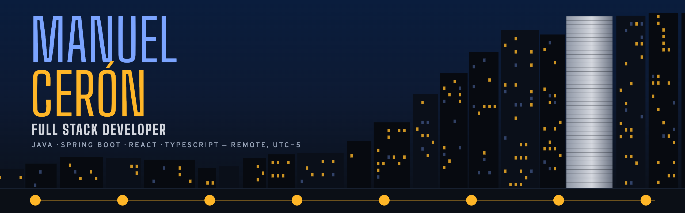

I build web products end to end: **Java and Spring Boot APIs** underneath, **React and TypeScript** on top.
2+ years of professional work at Quantum Developers, remote from Cuenca, Ecuador (UTC−5). **Open to remote roles.**

**[Portfolio](https://manuelceron.vercel.app)** · **[LinkedIn](https://www.linkedin.com/in/manuel-cer%C3%B3n-564b52304/)** · **[CV (PDF)](https://manuelceron.vercel.app/files/CV_Manuel_EN.pdf)** · juanmanuelceronfernandez123@gmail.com

## Featured projects

| Project | What it does | Stack |
|---|---|---|
| **Cuentas Claras** · [live demo](https://cuentas-claras-manuel.vercel.app) · [repo](https://github.com/M4NUEL-CERON/cuentas-claras) | Split shared expenses with no sign-up: share a link, log who paid, and it works out who pays whom in at most n − 1 transfers. Money kept as integer minor units, so splits always add up. | Java 25 · Spring Boot 4 · PostgreSQL · Flyway · React · TypeScript · Docker |
| **CuteURL** · [live demo](https://m4nuel-ceron.github.io/CuteURL-Frontend/) · [backend](https://github.com/M4NUEL-CERON/CuteURL_Backend) · [frontend](https://github.com/M4NUEL-CERON/CuteURL-Frontend) | URL shortener with no sign-up. Atomic writes with Redis `SETNX`, retry on code collision, expiring links, 302 redirects. | Java 17 · Spring Boot · Redis · React · TypeScript · GitHub Actions |
| **API Performance Monitor** · [repo](https://github.com/M4NUEL-CERON/api-performance-monitor) | A REST API that measures itself: one endpoint returns live RPS, p50/p99/p99.5 latency per endpoint and JVM health, built on Micrometer. | Java · Spring Boot · Actuator · Micrometer · Prometheus · JPA |
| **Parce API** · [live](https://parce-api.vercel.app) · [repo](https://github.com/M4NUEL-CERON/parce-api) | Free public API of Colombian sayings and dishes, with recipes, photos, search and filters by region, plus a page to explore it. | Node.js · Vercel Functions · REST |
| **Portfolio** · [site](https://manuelceron.vercel.app) · [repo](https://github.com/M4NUEL-CERON/portfolio) | My work drawn as a night transit network. Bilingual (EN/ES), statically rendered. | Next.js · TypeScript · Vercel |

## At work

**Full Stack Developer · Quantum Developers** (Aug 2024 — now)

- Rewards and points-redemption APIs on AWS Lambda, integrating Uber, Bancolombia and Rappi
- Real-time chatbot over WebSockets (STOMP), with Redis Pub/Sub carrying messages across instances
- Performance monitoring app with Spring Boot, Actuator, Micrometer and Prometheus
- AI application on AWS Bedrock, and web apps with React, Next.js and TypeScript

## Stack

